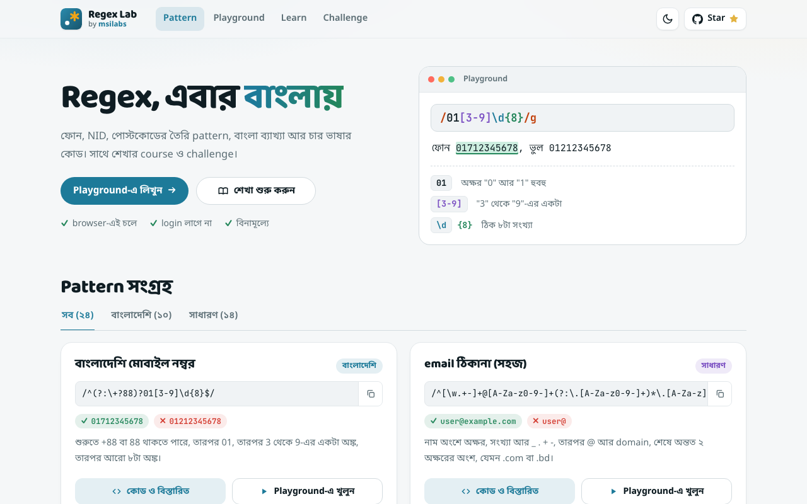
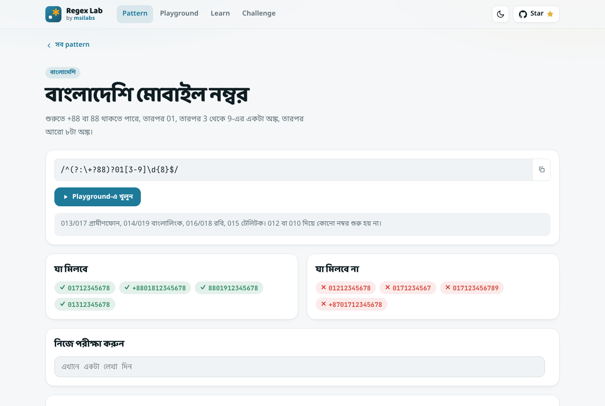
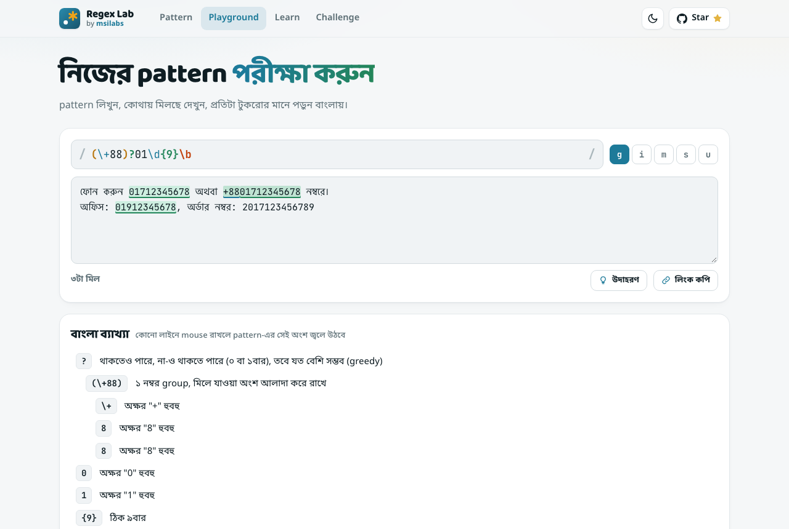
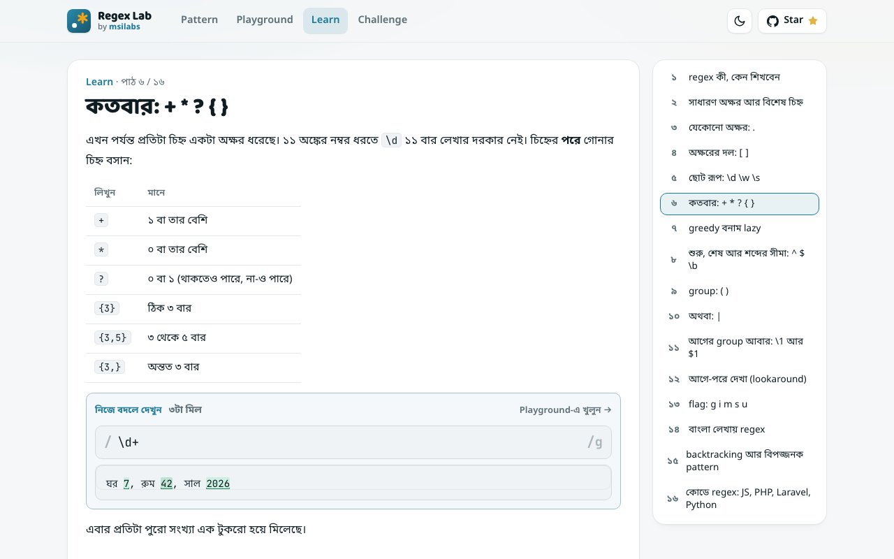
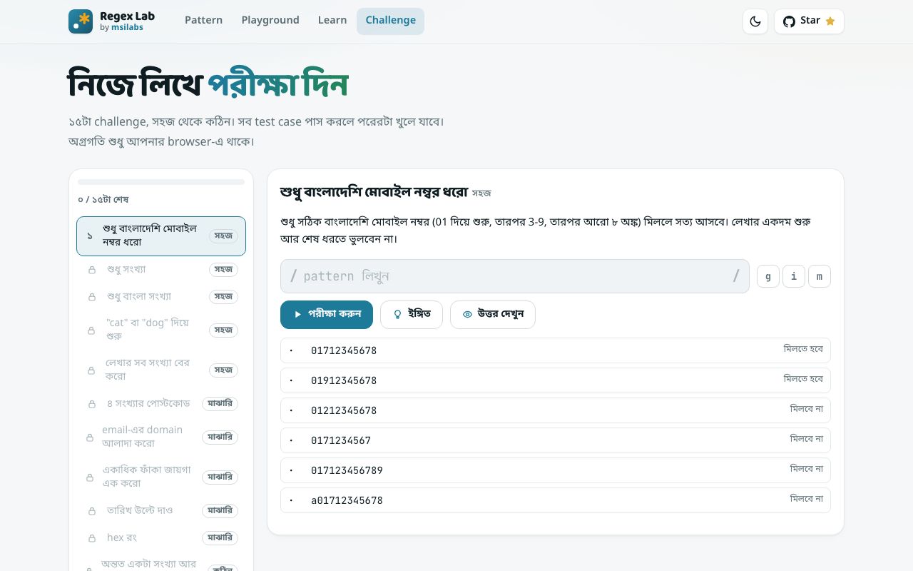

# Regex Lab

বাংলায় regex শেখা আর পরীক্ষা করার জায়গা। বাংলাদেশি ফোন, NID, পোস্টকোডের তৈরি pattern, প্রতিটা টুকরোর বাংলা ব্যাখ্যা, শুরু থেকে শেখার course আর challenge। সবকিছু browser-এ চলে, login লাগে না, আপনার লেখা কোথাও পাঠানো হয় না।

🔗 **লাইভ:** https://msilabs.github.io/regex-lab/



## কী কী আছে

### Pattern সংগ্রহ
২৪টা তৈরি pattern: বাংলাদেশি মোবাইল নম্বর (ইংরেজি আর বাংলা সংখ্যায়), NID, পোস্টকোড, লাখ-কোটির কমাসহ টাকার অঙ্ক, বাংলা অক্ষর, বাংলা নাম, বাংলা hashtag, আর email, URL, UUID, তারিখের মতো সাধারণ pattern। প্রতিটার উদাহরণ test দিয়ে যাচাই করা। এক ক্লিকে কপি, আর JavaScript, PHP, Laravel আর Python-এর কোড তৈরি।



### Playground
pattern লিখুন, লেখায় কোথায় মিলছে সাথে সাথে রঙে দেখুন। প্রতিটা টুকরোর মানে বাংলায় আসে। `(a+)+$`-এর মতো বিপজ্জনক pattern দিলে আগেই সতর্ক করে, আর browser আটকে যায় না, কারণ সব কাজ আলাদা Web Worker-এ চলে।



### Learn
১৬টা ছোট পাঠ, শুরু থেকে: সাধারণ অক্ষর, `[ ]`, `\d`, quantifier, greedy আর lazy, `^ $ \b`, group, lookaround, flag, বাংলা লেখায় regex, backtracking আর ReDoS, আর কোডে ব্যবহার। প্রতিটা পাঠে এমন উদাহরণ আছে যা নিজে বদলে দেখা যায়।



### Challenge
১৫টা অনুশীলন, সহজ থেকে কঠিন। সব test case পাস করলে পরেরটা খুলে যায়। progress শুধু আপনার browser-এ থাকে।



## চালানো

সাইট বানানো হয় [আলো (Alo)](https://github.com/msilabs/alo) দিয়ে। Node.js ২২ বা নতুন ভার্সন লাগবে।

```bash
npm install
npm run dev     # http://localhost:3000
npm run build   # dist/ ফোল্ডারে সাইট
npm test        # engine, pattern, পাঠ আর challenge-এর test
```

GitHub Pages-এর মতো সাব-পাথের জন্য: `node alo build --base /regex-lab/`

Web Worker লাগে, তাই `dist/` সরাসরি `file://` দিয়ে খুললে চলবে না। যেকোনো static server দিয়ে চালান।

## পেজ

| ঠিকানা | কী আছে |
|---|---|
| `/` | Pattern সংগ্রহ, ধরন অনুযায়ী বাছাই |
| `/pattern/<slug>/` | একটা pattern: উদাহরণ, নিজে পরীক্ষা আর চার ভাষার কোড |
| `/playground/` | live মিল, বাংলা ব্যাখ্যা আর ReDoS সতর্কবার্তা |
| `/learn/` | ১৬টা পাঠের course |
| `/challenge/` | test case সহ অনুশীলন |

## ফাইল কোথায়

```
pages/                 প্রতিটা পেজ, উপরের টেবিলের মতো
components/            SiteHeader (মেনুসহ), SiteFooter, PatternCard, PatternCode
data/pattern/*.json    তৈরি pattern (প্রতিটা একটা file)
data/learn/*.md        Learn-এর পাঠ
data/challenges/*.json challenge
global/engine.js       worker-এর client আর ছোট helper
global/style.css       সব CSS
public/engine/         worker আর engine (parser, explain, tracer, redos, codegen, challenge)
tests/                 node --test
docs/screenshots/      README-র ছবি
```

## নতুন কিছু যোগ করা

- **pattern:** `data/pattern/<slug>.json`-এ `title`, `category` (`bd` বা `common`), `pattern`, `flags`, `explain`, `should_match`, `should_not_match`, `notes` আর `order` (তালিকায় কত নম্বরে দেখাবে) দিন।
- **পাঠ:** `data/learn/<slug>.md`-এ front matter-এ `title`, `order`, `summary` দিন। চেষ্টা করার বাক্স বানাতে ```` ```regex ```` ব্লক লিখুন: প্রথম লাইনে `/pattern/flags`, বাকি লাইনগুলো লেখা।
- **challenge:** `data/challenges/16-নাম.json`-এ `title`, `level`, `type` (`match`, `extract`, `replace`), `task`, `cases`, `hint`, `solution`, `flags` দিন।

তারপর `npm test` চালান। উদাহরণ, পাঠের regex বা solution ভুল হলে, অথবা কোনো library pattern-এ ReDoS ঝুঁকি থাকলে test ফেল করবে।

উদাহরণে কারো আসল ফোন নম্বর দেবেন না। `01712345678` ধরনের ক্রমিক নম্বর ব্যবহার করুন।

## অবদান

ভুল pattern, ভুল বাংলা ব্যাখ্যা বা নতুন pattern-এর প্রস্তাব থাকলে [issue খুলুন](https://github.com/msilabs/regex-lab/issues)। pull request-ও স্বাগত।

## License

[MIT](LICENSE)
